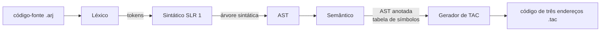

<h1 align="center">Compilador Arjanov</h1>

<p align="center">
  Compilador da linguagem <b>Arjanov</b>, desenvolvido para a disciplina de Compiladores.<br>
  Análise léxica, sintática SLR(1), semântica e geração de código de três endereços,<br>
  tudo escrito à mão em Python, sem geradores de analisadores.
</p>

<p align="center">
  
  
  
  
</p>

---

## Sumário

- [Visão geral](#visão-geral)
- [Situação das fases](#situação-das-fases)
- [Como executar](#como-executar)
- [A linguagem Arjanov](#a-linguagem-arjanov)
- [Arquitetura](#arquitetura)
- [Estrutura do repositório](#estrutura-do-repositório)
- [Documentação](#documentação)
- [Como contribuir](#como-contribuir)

## Visão geral

O compilador lê um programa `.arj` e o processa em quatro fases. Cada fase só
roda se a anterior terminar sem erros, e os erros de uma mesma fase são
acumulados, não interrompem a análise:



Cada erro indica linha e coluna. Trecho da saída para `exemplos/erros.arj`:

```
Erros Léxicos: 1
  Linha 9, Coluna 15: Caractere não reconhecido: '@'

Erros Sintáticos: 4
  Linha 7, Coluna 14: encontrado ')' (')'); esperado um de: ';'
  ...
```

A fase semântica seguirá o formato definido na especificação:
`[Erro Semântico] Linha L, Coluna C: mensagem` e `[Aviso Semântico] ...`.

## Situação das fases

| Fase | Módulos | Situação |
|---|---|---|
| Análise léxica | `src/lexer.py`, `src/tokens.py` | ✅ concluída (Parte 1) |
| Análise sintática SLR(1) | `src/grammar.py`, `src/slr.py`, `src/sintatico.py` | ✅ concluída (Parte 2) |
| Léxico e gramática da Versão B | `src/tokens.py`, `src/grammar.py` | ✅ concluída (84 produções, 146 estados, 0 conflitos) |
| Árvore sintática abstrata | `src/arvore.py` | ✅ concluída |
| Análise semântica | `src/semantico.py` | ⏳ próxima etapa |
| Geração de código de três endereços | `src/tac.py` | ⬜ planejada |

O roteiro detalhado, com checklists por fase, está em
**[`docs/PLANO.md`](docs/PLANO.md)**.

## Como executar

Requisito: **Python 3.9 ou superior**. Não há dependências externas.

```sh
git clone https://github.com/Noturn1/analisador_semantico.git
cd analisador_semantico

python3 run.py exemplos/ExemploArjanov.arj            # analisa um arquivo
python3 run.py exemplos/ExemploArjanov.arj --tokens   # inclui a tabela de tokens
python3 run.py exemplos/ExemploArjanov.arj --acoes    # inclui o traço shift/reduce
python3 run.py exemplos/ExemploArjanov.arj --ast      # inclui a árvore sintática abstrata
python3 run.py --demo                                 # analisa um programa embutido
python3 run.py --help                                 # ajuda
```

`run.py` é um atalho para `src/main.py`.

| Código de saída | Significado |
|---|---|
| `0` | programa aceito |
| `1` | foram encontrados erros |
| `2` | erro de argumentos ou de leitura do arquivo |

Ao final, o compilador imprime o veredito:

```
Resultado
  REJEITADO — foram encontrados erros.
  Léxicos: 1 | Sintáticos: 4
```

## A linguagem Arjanov

Programas são formados por funções; a execução começa em `main`. Na Parte 3 a
linguagem adota a **Versão B** da especificação semântica (ver
[`docs/DECISOES.md`](docs/DECISOES.md) #10): parâmetros tipados, tipo de
retorno opcional, `NOT`, menos unário, conversões `int(e)`/`float(e)`,
`break` e `default`.

```c
func fat(int n): int {
    if (n <= 1) {
        return 1;
    }
    return n * fat(n - 1);
}

func media(int a, float b): float {
    return (a + b) / 2;
}

func mostra(str msg) {
    puts(msg);
}

func main(): int {
    int x;
    float m;
    input(x);
    m = media(x, 2.5);
    int k = int(m) + fat(x);
    ...
}
```

| Elemento | Valores |
|---|---|
| Tipos | `int`, `float`, `str`, `bool` |
| Controle | `if`/`else`, `while`, `for`, `switch`/`case`/`default`, `break`, `return` |
| E/S | `puts(...)`, `input(var)` |
| Operadores (menor → maior precedência) | `OR` · `XOR` `XNOR` · `AND` · `NOT` · `== != < > <= >=` · `+ -` · `* / %` · `-`/`+` unários · `^` |
| Literais | `10`, `2.5`, `'texto'` (aspas simples), `true`, `false` |

> Programas no formato da Parte 2 (parâmetros sem tipo, como `func soma(a, b)`)
> não são mais aceitos. `exemplos/ExemploArjanov.arj` mostra a sintaxe atual.

## Arquitetura

| Módulo | Responsabilidade |
|---|---|
| `src/tokens.py` | `TokenType`, palavras reservadas e a classe `Token` |
| `src/lexer.py` | autômato do léxico, com recuperação em modo pânico |
| `src/grammar.py` | gramática livre de contexto da Versão B (84 produções numeradas, Apêndice A da spec) |
| `src/slr.py` | itens LR(0), CLOSURE/GOTO, FIRST/FOLLOW e tabelas ACTION/GOTO |
| `src/sintatico.py` | parser SLR(1) dirigido pela tabela, árvore sintática e recuperação de erros |
| `src/arvore.py` | nós da AST, conversão árvore sintática → AST e impressão (`--ast`) |
| `src/main.py` | interface de linha de comando e encadeamento das fases |

Alguns princípios do projeto, detalhados em [`docs/DECISOES.md`](docs/DECISOES.md):

- **Sem geradores**: Lex/Yacc, PLY e ANTLR não são usados (#1).
- **Erros acumulados**, nunca exceções; o compilador reporta todos de uma vez (#2).
- **Modo pânico** no parser, sincronizando em `comando`, `bloco` ou `funcao` (#5).
- **AST** entre o parser e as fases seguintes, independente da gramática (#11).

## Estrutura do repositório

```
.
├── run.py                 atalho para src/main.py
├── src/                   código-fonte do compilador
├── exemplos/              programas de entrada em Arjanov
│   ├── ExemploArjanov.arj   programa válido
│   └── erros.arj            programa com erros léxicos e sintáticos
└── docs/
    ├── PLANO.md                                plano de implementação da Parte 3
    ├── DECISOES.md                             registro de decisões de projeto
    └── Especificacao_Semantica_Arjanov_v2.pdf  especificação semântica e do TAC
```

A versão entregue na Parte 2 está marcada com a tag `parte-2`
(`git checkout parte-2`).

## Documentação

| Documento | Conteúdo |
|---|---|
| [`docs/PLANO.md`](docs/PLANO.md) | o que falta fazer, fase por fase, com checklists |
| [`docs/DECISOES.md`](docs/DECISOES.md) | por que o compilador é como é; os módulos citam as entradas pelo número |
| [`docs/Especificacao_Semantica_Arjanov_v2.pdf`](docs/Especificacao_Semantica_Arjanov_v2.pdf) | sistema de tipos, escopos, catálogo de erros (E01–E26, W01–W02), esquemas de TAC e gramática da Versão B |

## Como contribuir

1. Escolha a próxima fase em [`docs/PLANO.md`](docs/PLANO.md) e leia a seção
   correspondente da especificação.
2. Crie um branch: `git switch -c fase-3-semantico`.
3. Antes de cada commit, confira que os exemplos se comportam como esperado:
   ```sh
   python3 run.py exemplos/ExemploArjanov.arj   # deve ser aceito
   python3 run.py exemplos/erros.arj            # deve ser rejeitado
   ```
4. Registre decisões novas no final de `docs/DECISOES.md` e marque os itens
   concluídos no plano.
5. Abra um pull request para `main`.
